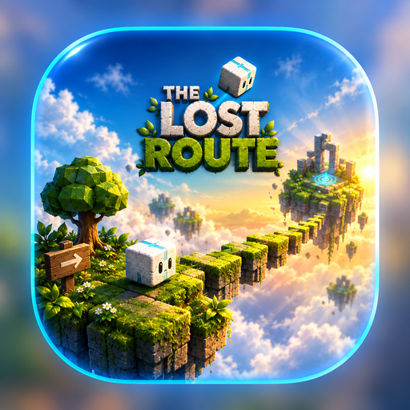
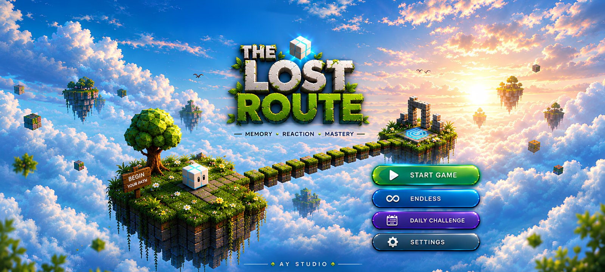
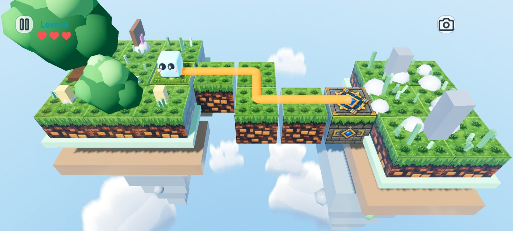
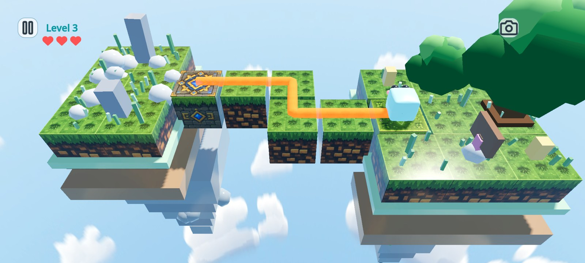
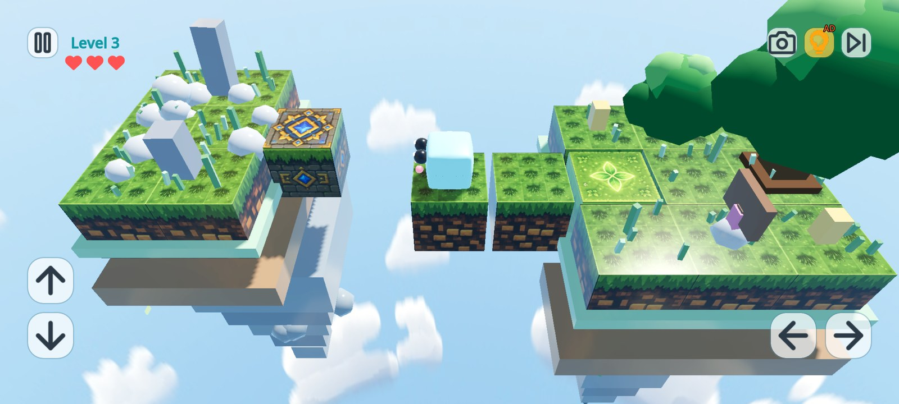
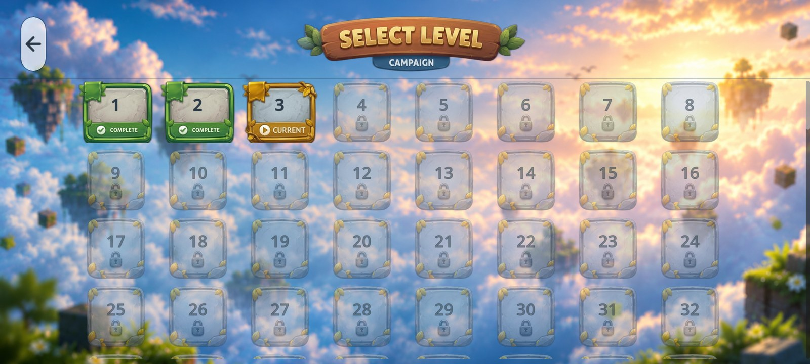

<h1>The Lost Route</h1>

**Memory. Reaction. Mastery.**

A handcrafted 3D block-puzzle adventure across floating islands.

Free to play · Android 7.0+ · Contains ads

---

## Find your way home

The Lost Route is a **3D memory puzzle** set among floating islands. Watch the route light up, then guide your little cube across the path before your memory fades.

Every level is a short, satisfying challenge. One wrong step costs a heart — and the next move is always yours.

## Download

The latest build is ready to play.

**[Download the latest APK →](https://github.com/ayush4151y/the-lost-route-releases/releases/latest/download/the-lost-route.apk)**

**v1.0** · About **180 MB** · Android **7.0+** · No account needed

> **Updating from an older build?** If Android refuses to install this version, uninstall the old one first. Local progress is stored on your device and will be cleared.

## How to install

1. Tap **Download APK** above.
2. Open the downloaded file.
3. If Android asks, allow installs from your browser or file manager.
4. Open **The Lost Route** and start your first route.

## What's inside

- 🧠 **Memory-first puzzles** — the path appears, then disappears. Repeat it from memory.
- 🧊 **Tricky blocks** — slide on ice, dodge fire, defuse TNT, and grab extra hearts.
- 🏝️ **200 levels** — a full campaign across floating islands.
- ♾️ **Endless mode** — chase your best streak as the paths get longer.
- 📅 **Daily Challenge** — a new route every day, with a streak to protect.
- 🎮 **Play your way** — swipe or use the on-screen controls.
- 📱 **Made for mobile** — adaptive quality keeps older phones smooth.

## Screenshots

  

  

  

## Feedback

Found a bug? Have an idea for a new block, mode or level? I'd love to hear it.

**[Share your feedback →](https://github.com/ayush4151y/the-lost-route-releases/issues/new)**

Please include:

- your phone model
- your Android version
- what happened, and what you expected

English or Hindi — both are welcome.

---

Made with [Godot Engine](https://godotengine.org/) by **AY Studio**.

Thanks for playing. See you on the route.

